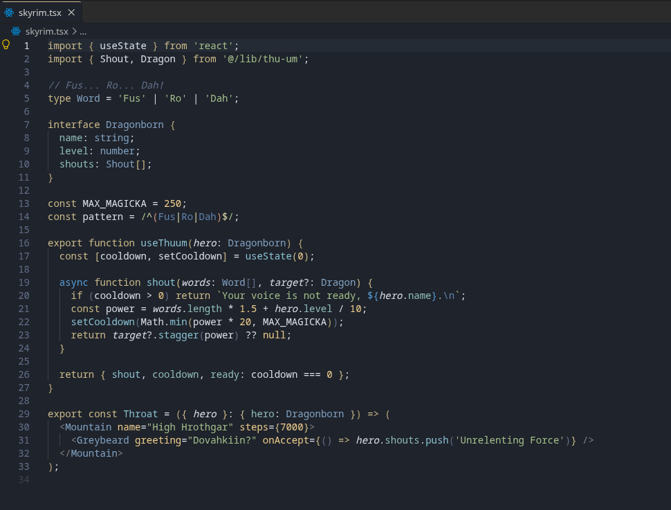

# Skyrim Theme

I used to be a software engineer like you. Then I took an AI in the knee.

A dark VS Code theme inspired by Bethesda's **The Elder Scrolls V: Skyrim**.

## Install

Search for **Skyrim Theme** in the Extensions view, install it, then pick **Skyrim** with *Preferences: Color Theme*.
